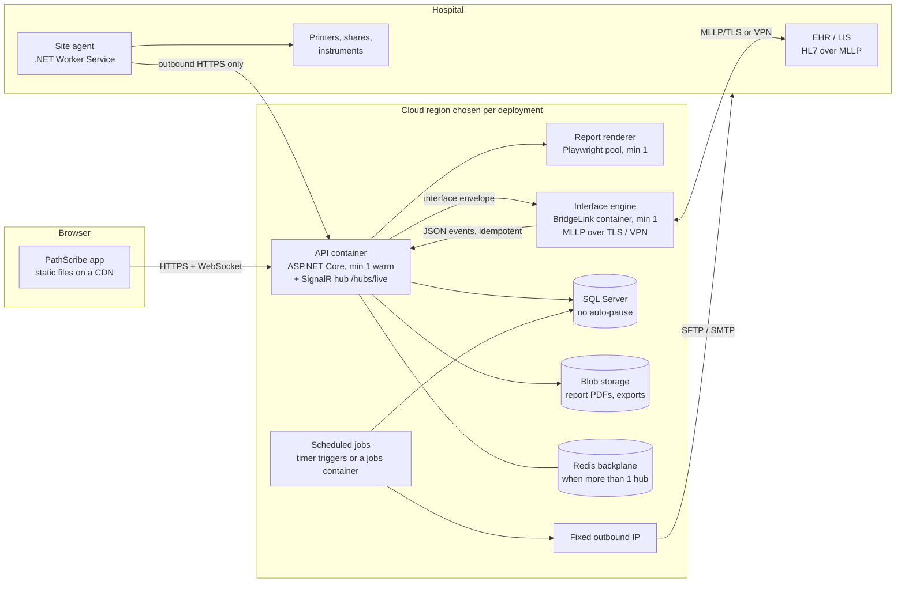
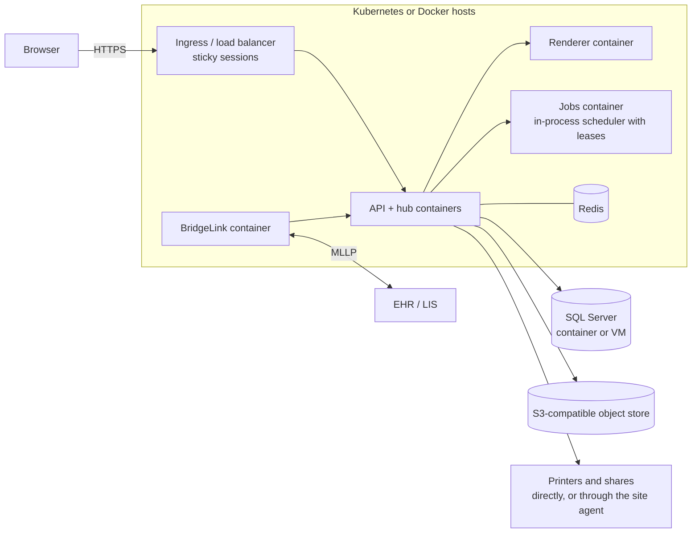

# Deployment readiness review: serverless, private cloud and on-site (PS-539, phase 2a)

*Written Oct 12, 2026 (Batch 537). **Updated Oct 14, 2026 (Batch 570): section 0 gives the status after phases 2a to 2d.** It is checked against the code in this workspace and against the providers' own documentation as of Oct 12 (sources are at the end; provider facts were not re-checked for this update). Provider rules change often, so re-check any provider fact before a hospital relies on it.*

**What this is.** This review covers every part of PathScribe that has to run on a server. For each part it gives a rating, then lists what has to change, ranked by how much it would block a deployment. It also includes the latency budget for a 1-second screen refresh, a table of markets and their hosting rules, cost notes, diagrams, and the decisions Pete made (phase 2b, all decided Oct 12–13). The contracts (2c), front-end batches (2d) and reference implementations (2e) follow from it.

**What this is not.** It is not a choice of cloud. Per Pete's correction of Oct 10, **the architecture, code and validation are cloud-agnostic.** Provider services appear here only as optional adapters behind interfaces. Where ForMedrixAI hosts its own service first is a business decision and doesn't change the code.

---

## 0. Status at Batch 570 (Oct 14, 2026), with what changed by Batch 641 in section 0.8

**In one line:** the browser side of every change this review asked for is built and tested; the server side (phase 2e) is not started, so **PathScribe cannot yet be deployed to production anywhere.** The six blockers in section 12 are all server work.

### 0.1 Where each phase stands

| Phase | What it is | Status | Batches |
|---|---|---|---|
| 2a | This review | **Done** | 537 |
| 2b | Pete's decisions D1 to D7 | **Done**, all seven (section 13) | 541 |
| 2c | Server contracts | **Done** for every item the review asked for: report documents and rendering, message bus and jobs, asynchronous exports, blob storage, the interface-engine edge, the site agent, live-update data topics | 538, 539, 542 to 546, 559 |
| 2d | Browser changes (section 9) | **Done, browser side, all ten items** (0.2) | 547 to 562 |
| 2d+ | Accessibility to WCAG 2.1 AA, checked in a real browser (0.5) | **Done for everything a machine can check**; screen-reader testing by a person is open | 563 to 570 |
| 2e | Reference server, endpoints, jobs, hub, agent | **Not started.** Built by the India team from the contracts | — |

### 0.2 Section 9 (browser changes), item by item

| # | Item | Browser side | Still needed (phase 2e unless noted) |
|---|---|---|---|
| 1 | Runtime configuration | Done (547, 549, 557): one server build; `/config.json`; `/api/config` read | The `/api/config` endpoint |
| 2 | Reconnect banner, loading states | Done (548, 549); checked in a browser (563) | NVDA / VoiceOver by a person; the "Reconnecting" case needs the hub (PS-653) |
| 3 | Browser stand-ins for server jobs; push instead of polling | Done (555; 559 to 562) | The jobs themselves (section 7) and the hub's `DataChanged` topics |
| 4 | Interface monitoring | Done (554) | `/api/interface/engines` and the engines' heartbeat |
| 5 | PDF location | Done (538, 539) | The renderer service hosted always-on |
| 6 | On-site agent screens | Done (552, 553) | The agent itself and its endpoints; instruments in agent version 2 (D3) |
| 7 | Hosting region shown to admins | Done (536, 557) | `/api/config` `hosting` |
| 8 | Content-Security-Policy per deployment | Done (546, 547) | A browser check of the print bridges (`SITE_AGENT_API.md` §12, test 10) |
| 9 | Exports through the server | Done (550) | Export endpoints, job and blob storage |
| 10 | "Server jobs" view | Done (551) | `/api/jobs` endpoints |

### 0.3 Section 12 (what blocks a deployment), now

| # | Change | Status |
|---|---|---|
| 1 | API server and SQL schema | **Open** (2e; India team) |
| 2 | Blob storage | Contract done (543); browser reads report documents and versions through the API (556, 558); **storage and endpoints open** |
| 3 | Server-side scheduled jobs | Browser hands each job over when the server lists it (555); **the jobs are open** |
| 4 | Report renderer service | Cytology template done (539); development renderer only; **the hosted service is open** |
| 5 | Authentication BFF and runtime config | Runtime config done (547); **BFF open** |
| 6 | Interface engine always-on, with the edge rules | Contract done (545); **hosting and the API endpoints open** |
| 7 | On-site agent | Contract and screens done (546, 552, 553); **the agent is open** |
| 8 | Warm floors, no auto-pause, push | Push done in the browser (559 to 562); **hosting settings and the hub open** |
| 9 | Retire Vercel `api/`, Firestore services and `functions/` | **Open** (F2 still applies: three screens read Firestore) |
| 10 | Dead engine-notification hook (F1) | Done (549) |
| 11 | CSP for the local print bridges (F4) | Done (546); browser check open |

### 0.4 Findings (section 14), now

| Finding | Status |
|---|---|
| F1 dead engine hook | Fixed (549) |
| F2 three screens on Firestore (Engraver Monitor, QA deficiencies, material tracking history) | **Open**: still the case in the code on Oct 14; needs API endpoints (change 9) |
| F3 network printing from the browser | Fixed (546, 549); printing itself waits for the site agent |
| F4 CSP for print bridges | Fixed (546); browser check open |
| F5 no scheduler for Assist polling or print batches | **Open** (server jobs) |
| F6 PDF storage and cytology PDFs | Fixed (538, 539) |
| F7 CLIA screening time measured in the browser | **Decided** (Pete, Oct 14): the server records screening events with its own clock and each person signs off their hours at the end of the day (option C, `CYTOLOGY_QC_API.md` §5). Browser side built (Batch 572); the server side is phase 2e |
| F8 CSV formula injection | Fixed (543) |
| F9 disposal export not audited | Fixed (543) |
| F10 engine webhook claims | Fixed (545, 549) |
| F11 outbound interface messages posted by the browser without a credential | **Open** (2e: the API calls the engine) |
| F12 no retry or dead letter for interface queues | **Open** (2e) |

### 0.5 Accessibility (new since the first version; matters to hospital procurement)

- **Automated, in a real browser, on every batch** (`npm run test:a11y`, Playwright and axe-core, WCAG 2.1 A and AA rules): every top-level screen (38), every Configuration section, the case report and organ map, the screens' other states (tiles selected, a case selected, a batch opened, charts), the connection banner and loading states, the inbox, the saved-search chips, keyboard focus after deletes. Batch 570: **70 checks pass** (5 skipped are Configuration tab numbers past the last tab).
- **In the code, on every test run, with no exception list:** every clickable element works from the keyboard; every field has a name; no control sits inside another (a check that also reads hand-made controls); no inline styles; every on-screen string translated; patient identifiers tagged for redaction.
- **Fixed in Batches 563 to 570:** colour contrast across the app (the dim grey and about 500 more rules), selected tiles announced, rows that held their own buttons, focus kept after a delete, the screenshot view as a proper dialog.
- **Not yet done, and needed before a hospital relies on it:** testing with real screen readers (NVDA on Windows, VoiceOver on Mac) by a person, using the manual screen reader test plan for the QC team (written Oct 14; 38 scripts; its run is Xray PS-687). Also open: contrast the checker can't measure on the translucent tiles, real displays, Firefox dragging in the template builder, and native-speaker review of the translations (Korean especially).
- **CI pipeline written, not yet running** (PS-471, Batch 615): `.github/workflows/ci.yml` runs type check, lint, tests and build, and the Python report tests, on every push to `main` and every pull request. It starts working once the repository is on GitHub (PS-468); until then the checks run on each batch here.

### 0.6 Decisions still open for Pete

1. ~~**`DataChanged` (one hub event with topics) in place of `ReceiveExceptionCountUpdate`**, and the hub name `/hubs/live`.~~ **Decided (Pete, Oct 14): `DataChanged` with topics, on `/hubs/live`; future live screens get a topic, not an event of their own** (section 5; `LIVE_UPDATES_SIGNALR.md` §14).
2. ~~**Organ-map events**~~ **Decided (Pete, Oct 14):** a `caseReport` topic tells an open case report at once that someone else saved the case (any write, organ-map figures included; Batch 572), and presence ("also viewing", with whether they are editing) is built browser-side in Batch 573 (`LIVE_UPDATES_SIGNALR.md` §15; the server issues each case's support reference, `CASE_API.md` §8). `organMapConfigChanged` stays proposed.
3. ~~**F7:** whether the server trusts the browser's screening-time figure.~~ **Decided (Pete, Oct 14): no.** Server-recorded screening events plus an end-of-day sign-off of hours by each person (option C; `CYTOLOGY_QC_API.md` §5).
4. **Translations:** native-speaker review of fr/de/nl/ko/es before clinical use (Spanish was added after this review; review workbooks for all five exist, Batch 637).

### 0.7 Test status at Batch 570 (latest full run, Batch 640: 1,697 files, 14,256 tests pass, the same single failing file; type-check clean; the browser accessibility checks were last run at Batch 570)

- vitest: 9,794 tests pass in 1,169 files; the only failing file is `firestore.rules.test.ts`, which needs the Firebase emulator and goes with change 9.
- Browser accessibility checks: 70 pass.
- Server build and demo build both build; the first load is 0.70 MB gzipped (target 1 MB).

### 0.8 Since Batch 570 (refreshed Batch 641, Oct 20, 2026)

The picture above still holds: **the browser side is built and the server side (phase 2e) is not started, so PathScribe cannot yet be deployed to production.** Changes since that add server work or a decision, and none removes a blocker:

- **CI pipeline** (PS-471, Batch 615): written, runs once the repository is on GitHub (PS-468, end of October).
- **CSMS eligibility gate** (Batches 636 and 638): the server must hold the CSMS message as `AWAITING_ELIGIBILITY`, release or close it on the eligibility answer, and refuse a Resend (`REGISTRY_ACKNOWLEDGEMENT_API.md` §10).
- **Recall settings** (Batches 632 and 640): the screening strategy settings now carry per-country recall windows and the laboratory's wording; the server stores, validates and audits them (`CYTOLOGY_API.md`). The register's recommendation codes are the interface engine's to map.
- **Registry batch files** (Batch 620): the batch feed and its server job are in `BATCH_REGISTRY_FEED_API.md`; CSMS-closed (`NOT_ELIGIBLE`) records are left out.
- **Surgical results through the outbound queue** still run on the demo's mock queue; the real queue is server work (the demo's surgical patients were added to the patient index in Batch 638 so the demo queues them).
- **Dictation:** a Belgian Dutch option exists (Batch 638); it needs a Belgian speaker to test, and no server work.
- **Languages:** Spanish is the sixth; translations in all five non-English languages still need native-speaker review.

## 1. Summary for a hospital IT review

- **PathScribe is a browser application backed by an API server.** The browser holds no keys and no patient data at rest. The production server is ASP.NET Core on Microsoft SQL Server, with live updates over SignalR. It is built from standard parts that run anywhere: containers, SQL Server, a message broker, TLS certificates. It does not depend on any one cloud provider's services.
- **There are two supported ways to host it:**
  1. **A public cloud,** using the provider's managed database and container hosting where available.
  2. **The portable package:** the same containers on Kubernetes or Docker in a private cloud, a sovereign cloud, or the hospital's own data centre.

  The package is validated once. Each hosting location then gets an installation qualification checklist, not a full re-validation.
- **Some parts must always be running.** "Serverless" in the sense of scaling to zero isn't compatible with a 1-second screen refresh, or with STAT cases at night. The always-on parts are:
  - the API (with at least one warm instance);
  - the database (never auto-paused);
  - the live-update hub;
  - the PDF renderer;
  - the interface engine that holds HL7 connections.

  Background jobs (retries, release timers, expiry checks) can run as short scheduled tasks.
- **On site, the hospital installs one small agent:** a Windows service that connects outbound over HTTPS. Printers, Windows file shares and instruments on the hospital network are reached through it. No inbound firewall opening is needed for printing or file drops.
- **HL7 connections** (orders in, results out) use the interface engine (BridgeLink). It runs as an always-on container, at ForMedrixAI or in the hospital. The HL7 link is secured with a site-to-site VPN or MLLP over TLS. A message is acknowledged only once it has been stored durably.
- **Data residency:**
  - The hosting region is chosen per deployment.
  - Every AI call is checked against the jurisdiction's allowed AI vendors and regions (Batch 536).
  - Markets that require national or sovereign hosting use the portable package on a qualifying provider or on premises (section 10).

## 2. What exists today (inventory)

There is **no production server code in this workspace**: no `.cs`, `.csproj` or `.sql` files. The India team builds the server from the contracts in this folder. What does exist:

| Area | What is in the repo | Notes |
|---|---|---|
| Browser app | `src/` (React, Vite) | Deployment-neutral since Batch 506. UI code reaches data only through services (`deploymentReadiness.guard.test.ts`, empty baseline), and patient data isn't written to the browser when an API server is configured (PS-485, Batch 525). |
| Server contracts | 22 contracts (plus the README and the interface specification `.docx`) in `docs/architecture/` | Listed in section 3, with what each asks of the server. |
| Development receiver | `functions/main.py`, `functions/report_delivery.py` (Python, Firebase HTTPS functions) | `render_report` builds report PDFs with ReportLab. `receive_interface_message` validates the interface envelope and, for `REPORT_DELIVERY`, sends e-fax (SMTP) or a file drop (folder or SFTP via paramiko). It writes received envelopes to Firestore. **No MLLP, no HL7, no ACKs, no scheduler.** This is a test stand-in, not the product server. |
| Vercel functions | `api/webhooks/engine/*`, `api/qa/deficiencies/*` (firebase-admin) | Engine webhooks (cassette dispatch outcome, block exception, material location, engraver status) with HMAC and idempotency, plus QA CAPA endpoints with unresolved authentication. Per their README, never run against a real deployment. **To be replaced by API endpoints**; see section 12. |
| Firebase leftovers | `firebase.json` (emulator only), `firestore.rules` (header: not deployed), `src/firebase/config.ts` (placeholder credentials), 33 `firestore*` service files, almost all with no importer | Three screens still reach Firestore-backed services: Engraver Monitor, the QA deficiency list, and the material tracking history. With placeholder credentials they can't reach real data. |
| Interface engine | BridgeLink (PS-331): Innovar's open-source fork of Mirth Connect, a Java server | PathScribe never builds HL7 for the wire. It sends a JSON envelope (15 transaction types, `INTERFACE_TRANSACTIONS.md`), and the engine maps it. Most of the HL7 parsers in `src/services/hl7/` (ADT, patient management) have no transport and no caller outside tests; moving them to the engine is recorded on PS-331. The exception is `hl7Parser.parseHL7Message`, which the Assist LIS adapter (`lisIngestion/adapters/hl7v2StatusAdapter.ts`) uses from the manual "Poll now" path. |

## 3. Every server-side component, rated

Ratings:
- **Ready:** runs as a short, stateless call or a scheduled job (function or scale-to-zero container).
- **Changes:** fits once the listed change is made.
- **Always-on:** needs a long-running process (a container with at least one replica).
- **On-site:** needs something on the hospital network.

| # | Component | Where it's specified | Rating | Why, and what it needs |
|---|---|---|---|---|
| 1 | Browser app (static files) | `deploy/security-headers/` | **Ready** | Served from a CDN or any static host. **Needs:** runtime configuration (section 9, item 1), and a Content-Security-Policy per deployment that lists the API, identity provider, hub and renderer origins and the local print bridges (finding F4; *the bridges are allowed by default since Batch 546*). |
| 2 | API server (ASP.NET Core) | `CASE_API.md`, `CASE_SEARCH_API.md`, `AUTHORIZATION_API.md`, the other `*_API.md` | **Always-on, minimum 1** | Request/response with database transactions. It could run as functions, but for the 1-second target it needs at least one warm instance (section 8). **Needs:** a container image with minimal APIs; business logic in class libraries that a container host and, optionally, a function host can both call. |
| 3 | Authentication (backend-for-frontend) | `AUTHENTICATION_OIDC.md` (decision of Oct 3) | **Changes** | Part of the API. The server holds the tokens; the browser gets an HttpOnly cookie and an anti-forgery header. **Needs:** shared session storage (SQL or Redis) so any instance can serve any request; runtime identity-provider configuration; step-up signature checks with `prompt=login`; SCIM. Not built yet. |
| 4 | Database (SQL Server) | `SYSTEM_ARCHITECTURE.md`, every `*_API.md` | **Always-on** | **Auto-pause must be off in production.** Details in section 4. |
| 5 | Live updates (SignalR hub and outbox dispatcher) | `LIVE_UPDATES_SIGNALR.md` | **Always-on** | The hub holds WebSockets. The dispatcher is an `IHostedService` that is woken on each commit and polls every 100 ms or less. Section 5. |
| 6 | Scheduled jobs (10 timers, plus the print-job and charge-outbox dispatchers) | `REPORT_DELIVERY_API.md`, `CONSULT_ACCESS_API.md`, `FOLLOW_UP_API.md`, `REGISTRY_ACKNOWLEDGEMENT_API.md` and others | **Ready**, once moved off the browser | Each is a short timer-triggered run with a lease so two runs never overlap. Today most run in the browser. Section 7. |
| 7 | Report PDF renderer | `REPORT_RENDERING_SERVICE.md` | **Always-on** | A warm pool of 2 to 4 Chromium instances (Playwright), a 5-second timeout, recycled after 500 renders, no network egress, a larger `/dev/shm`, and about 100 MB of CJK fonts. A cold start (browser launch plus fonts) breaks the release budget. **Needs:** cytology reports moved to it (they are made only in the browser today, finding F6). Decision D2, decided Oct 12 (section 13). |
| 8 | Report delivery: e-fax | `REPORT_DELIVERY_API.md` §serverless | **Ready** | An SMTP gateway on port 587 with authentication. Transmission reports come by provider webhook or mailbox. |
| 9 | Report delivery: SFTP file drop | same | **Changes** | Needs a **fixed outbound IP** for the hospital's allow-list (NAT gateway or firewall egress) and a pinned host key. |
| 10 | Report delivery: Windows share | same, :105 | **On-site** | A cloud server can't reach a hospital share. **Needs:** the on-site agent (section 6), or SFTP instead. |
| 11 | Retry sweeps, dead letter, fallback channels | `REPORT_DELIVERY_API.md` PS-281 | **Ready** | Timer trigger every 30 to 60 s, with a lease or row lock. Never a sleep inside a call. |
| 12 | Interface engine (BridgeLink) and the MLLP edge | PS-331, `INTERFACE_TRANSACTIONS.md` | **Always-on, or On-site** | An MLLP listener holds TCP connections, and BridgeLink is a long-running Java server. Section 6. |
| 13 | Engine callbacks and events in | `INTERFACE_TRANSACTIONS.md` (`/api/v1/events/*`), `LIVE_UPDATES_SIGNALR.md` §10 (print callbacks), the Vercel `api/webhooks/engine/*` | **Ready** | Short HTTP calls with HMAC and idempotency keys. **Needs:** to move from the Vercel/Firestore stand-ins into the API (section 12). |
| 14 | Network and report printing | `LIVE_UPDATES_SIGNALR.md` §10, `services/printing/*` | **On-site** | Raw 9100, LPR and IPP need a socket on the hospital network. Today the code for them uses Node's `net` module and can't run in a browser (finding F3). **Needs:** the on-site agent, or the engine's `PRINT_JOB` route. |
| 15 | Label printing (ZPL) | `utils/labels/*` | **On-site** (workstation) | Uses QZ Tray or the PathScribe Agent on the workstation (`wss://127.0.0.1:9100-9102`). Fine as it is. *(The shipped CSP didn't list these origins, finding F4; fixed in Batch 546.)* Network label printers go through the site agent (`SITE_AGENT_API.md`, `print.label`). Labels triggered from the UI and labels triggered by HL7 orders should share one agent path (Pete, Oct 10). |
| 16 | Instruments: molecular, staining, cytology analysers, HPV | `MOLECULAR_ORDERS_API.md`, `INTERFACE_TRANSACTIONS.md` | **On-site** | Through the engine (BridgeLink channels per instrument), or ASTM/HL7 over serial or TCP through the on-site agent. Inbound instrument events are processed in the browser today, and need server endpoints. |
| 17 | Cassette engravers, WSI scanners | engine webhooks, `WSI_SCAN_MANIFEST` | **On-site** | Through the engine. Status comes back as events (row 13) and is pushed as `WsiScanBatchChanged`. |
| 18 | AI proxy | `AI_PROXY.md` (with the Batch 536 vendor policy) | **Changes** | Short calls, but streaming SSE must pass through. On Azure Functions an HTTP response is limited to 230 s; fine for AI calls. **Needs:** the per-jurisdiction check, per-call audit, keys in a secret store and rate limits. |
| 19 | Terminology proxies (UMLS, CPT, ICD-10) | `AI_PROXY.md`, `terminologyConfig.ts` | **Ready** | Short, stateless calls. |
| 20 | Email (`POST /api/notifications/email`) | `FOLLOW_UP_API.md` | **Ready** | SMTP relay on port 587. |
| 21 | File and blob storage | `REPORT_DOCUMENT_STORE_API.md` (report PDFs, Batch 538) | **Changes** | There is no server-side storage today. Report PDFs need blob storage, and since Batch 538 have a contract: one immutable document per release, with its SHA-256. Exports and held releases also need it, behind an interface (S3-compatible or Azure Blob), with retention. Images and attachments (photos, referral PDFs, signatures, logos) are **links only**: PathScribe stores no image or attachment files (Pete, Oct 13, 2026). Contract: `BLOB_STORAGE_API.md` (Batch 543), with the export contract `ASYNC_EXPORT_API.md`. *(Corrected in Batch 543: photos are not base64 in the browser; they go to the lab's imaging system and PathScribe keeps the URL. Corrected in Batch 544: the Batch 543 contract had planned containers for photos, attachments, signatures and logos; they are removed, and staff signatures, the one image PathScribe did keep, are now links.)* |
| 22 | Audit stores | `REPORT_CHANGE_LOG_API.md`, `ACCESS_CONTROL_PLAN.md` | **Changes** | Append-only tables (INSERT and SELECT grants only) and a hash-chained support-access stream. The AI audit log (`services/ai/AIAuditLog.ts`) is still in the browser. **Needs:** one write path, in the same transaction as the change it records. |
| 23 | Exports | `CASE_SEARCH_API.md` (synchronous, capped at 5,000 rows) | **Changes** | CSV and JSON are built in the browser today. Bigger exports (QA, disposal, audit) need an asynchronous job: request, run, notify, download from blob storage. *Contract written in Batch 542 (`ASYNC_EXPORT_API.md`); the browser side done in Batch 550.* |
| 24 | Assist LIS polling | `services/assistPolling/*` | **Ready**, once scheduled | There is **no scheduler at all** today, only a manual "Poll now" (finding F5). Needs a timer every `intervalMinutes`. |
| 25 | Development receiver, `functions/` | n/a | **Retire** | Keep only as a test stand-in until 2e's reference receiver replaces it (section 12). |

## 4. Database: SQL Server

**Hosting.** Every option runs the same SQL Server engine, so the schema and scripts are portable:
- Azure SQL Database (serverless or provisioned);
- SQL Server on a virtual machine;
- SQL Server in Linux containers (official images for 2017 to 2025 at `mcr.microsoft.com/mssql/server`, x86-64 Linux hosts only, licence required);
- AWS RDS for SQL Server.

**The Azure SQL serverless tier** (Microsoft, page updated Sep 29, 2026):
- Auto-pause can be set from 15 minutes (General Purpose) or 60 minutes (Hyperscale) up to 7 days, and **turned off with `-1`**.
- A paused database resumes on the next login. Microsoft warns of "temporary connectivity errors" and tells applications to retry. It gives no resume time; in practice the first connection fails and the next one succeeds within about a minute *(inferred, not on the page)*.
- On Hyperscale, auto-pause is still a preview feature.
- Billing is per second.
- Limits:
  - The minimum vCores depend on the size: 0.5 on the smallest, up to 10 on the 80-vCore size.
  - Worker limits rise with size: 75 at 1 vCore, 150 at 2, 300 at 4, up to 6,000 at 80.
  - Sessions are capped at 30,000 at every size.

**Recommendation:**
1. **Production databases never auto-pause.** A paused database turns the first screen load of the morning, or the first STAT case at 3 a.m., into a failed request and a retry measured in seconds. That breaks the 1-second target and the release timers. Auto-pause is fine for test and training tenants.
2. **Size by workers, not sessions.** Short-lived function instances each open connection pools. Keep the API and jobs on a small number of long-lived pools. The 75-worker limit at 1 vCore is the one that bites. Use a minimum of 2 vCores for a production tenant until load testing says otherwise.
3. **AWS has no serverless SQL Server.** RDS documents downtime when the instance class changes (Multi-AZ shortens it), so the "resize on a schedule" plan in the Oct 10 note isn't free. A licence cost also applies. This matters only for a deployment on AWS; the code doesn't change.
4. **Multi-step transactions** (sign-out → release → delivery) stay inside one database transaction plus the transactional outbox (`LIVE_UPDATES_SIGNALR.md`). Nothing waits across calls. The release delay is a row with a due time that a scheduled job picks up (section 7), never a timer held in memory.
5. **Audit integrity:**
   - The audit tables grant INSERT and SELECT only.
   - The support-access stream is hash-chained.
   - Each audit row is written in the same transaction as the change it records.
   - Backups use point-in-time restore. Immutable or WORM storage for exported audit archives is a per-hospital option.
6. **Schema changes** (decision D4):
   - Versioned SQL scripts, reviewed and applied by the deployment pipeline.
   - **Never migrate at application start-up.** Many instances would race to do it.
   - Every change must leave the database usable by the previous version (expand, then contract).

## 5. Live updates (SignalR)

**The hub logic lives in PathScribe's API, always.** How it scales out is a hosting adapter:
- **Azure public cloud:** Azure SignalR Service in Default mode. This is what the contract (`LIVE_UPDATES_SIGNALR.md` §7) specifies; no sticky sessions are needed.
- **Everywhere else** (other clouds, private, sovereign, on premises): self-hosted, with a Redis backplane and sticky sessions. This is the contract's private-cloud option.

This matches Pete's Oct 10 direction: self-hosted in the API by default, with Azure SignalR Service as an option only. *(Correction while checking this review: an earlier draft said the contract made self-hosting the default. It makes Azure SignalR Service the Azure option and self-hosting the private-cloud option; both keep the hub logic in the API.)* Microsoft's documentation confirms the details:

- **More than one hub instance on your own infrastructure needs sticky sessions, even with the Redis backplane.** Redis is Microsoft's "recommended scale-out approach" for self-hosting. Sticky sessions can be dropped only if every client uses WebSockets with `SkipNegotiation` (losing the SSE and long-polling fallbacks), or with Azure SignalR Service.
- **Azure SignalR Service:**
  - **Default mode** keeps the hub logic in PathScribe's server, which is what PathScribe needs.
  - **Serverless mode** moves it into Azure Functions bindings and webhooks. That would tie the hub logic to Azure.
  - **Classic mode** is not to be used.
  - Capacity is 1,000 concurrent connections per unit on Standard and Premium (20 on Free), up to 100 units per instance (Premium_P2: 100 to 1,000 units).
- **AWS API Gateway WebSockets is not a SignalR host.** It has a 2-hour maximum connection, a 10-minute idle timeout and a 128 KB message cap, and needs its own client protocol. It isn't recommended. On AWS, run the self-hosted hub in a container (ECS/Fargate or EKS) behind a load balancer with stickiness.

**Push, not polling.** Today these screens poll:
- the registry exceptions badge (60 s);
- messaging (20 s);
- Facility Ops (20 s);
- the Engraver Monitor (30 s, reading Firestore);
- held reports (5 s).

With the API server only, these also poll every 60 s, matching the one-minute heartbeats they show (*Batch 560 and 562:* now with the `siteAgents` and `interfaceEngines` topics as well):
- Site agents and the Print Queue's site agent line (Batch 552);
- Interfaces → Engines and the Interfaces line (Batch 554).

They can stay polls. An `AgentStatusChanged` or `EngineStatusChanged` hub event could replace them later; none is proposed yet. *(The Batch 552 polls weren't listed here in Batch 552.)* *(Superseded in Batch 559: the `siteAgents` and `interfaceEngines` data topics are those events.)*

Each needs a hub event in the contract:
- `ReceiveExceptionCountUpdate` is proposed in `REGISTRY_ACKNOWLEDGEMENT_API.md`; the hub name is still undecided, so use `/hubs/live`. *(Superseded, decided Oct 14: the `registryExceptions` topic of `DataChanged` on `/hubs/live`; see below.)*
- `molecularQueueChanged` is proposed in `MOLECULAR_ORDERS_API.md`. *(Batch 562: now the `molecularQueue` data topic; the Order Queue uses it.)*
- `organMapFigureChanged` and `organMapConfigChanged` are proposed in `ORGAN_MAPPING_API.md`. *(Batch 562: still proposed. No screen polls for them; an open report page learns of another user's figure change only when it saves (PS-71's version check) or reopens the case.)*
- Messaging, Facility Ops, held reports and engraver status have no event yet.

*Batch 559:* one hub event now covers these screens: `DataChanged`, with `SetDataTopics` to choose the topics (`LIVE_UPDATES_SIGNALR.md` §14). Topics: registry exceptions, messages, Facility Ops, held reports, the engravers, site agents and interface engines. It replaces `ReceiveExceptionCountUpdate` (*decided by Pete, Oct 14, 2026*: one event with topics, on `/hubs/live`; future live screens get a topic, not an event of their own). The browser's client is built, and *Batch 560* switched the screens over (`LIVE_UPDATES_SIGNALR.md` §14): each re-reads when its topic changes, keeps a one-minute safety poll while the hub has taken its topic, and polls as before otherwise. The hub side is phase 2e. *Batch 562:* the Print Queue's agent line follows `siteAgents` for every site it counts, and the Molecular Order Queue uses the new `molecularQueue` topic.

**Connections without a signed-in user** (password/demo sessions, OR wall boards) stay on polling until device tokens exist (`LIVE_UPDATES_SIGNALR.md` §4, §9).

## 6. Interface engine, MLLP and the on-site agent

### 6.1 The engine is the MLLP edge

BridgeLink is a Mirth Connect fork, and Mirth channels include MLLP listeners and senders. So **the "MLLP edge" in Pete's three patterns is the interface engine itself, not a new component.** The question is how it is hosted and how it hands messages to the API.

Pete's three patterns, checked against current documentation:

| Pattern | What it is | Fit for PathScribe |
|---|---|---|
| 1. Always-running container listener, then a queue, then processing | BridgeLink in a container with at least 1 replica, writing to a durable queue, then posting to the API. | **Recommended.** Works the same in any cloud, private cloud or on premises. On Azure Container Apps: external TCP ingress needs a VNet environment and allows up to 5 extra ports. Set minimum replicas to 1 or more: a scaled-to-zero listener can't hold the hospital's connection open, and Microsoft doesn't document how a TCP app wakes. On AWS: Fargate behind a Network Load Balancer (target type `ip`). |
| 2. Google Cloud Healthcare API MLLP adapter | Open source, shipped as a Docker image. Runs on GKE or on premises. | Feeds Google's managed HL7v2 store, which **ties processing to Google**. Not recommended as the core; acceptable only for a Google-hosted deployment that wants that store. |
| 3. Azure Logic Apps HL7 connector | Encode and decode in Standard workflows. | **Still in preview** (doc updated Nov 18, 2025). It has only encode and decode operations: **no triggers, no batching, no ACK generation, and no MLLP transport documented.** It can't hold the connection. Not suitable today. |

### 6.2 Rules for the edge (contract written: `INTERFACE_ENGINE_EDGE.md`, Batch 545)

1. **ACK only after a durable write.** The engine acknowledges an inbound message only once it is in durable storage: the engine's own message store, or the queue. A receipt alone isn't enough. Whether the ACK is an "accept" ACK (stored) or an "application" ACK (processed) is chosen per interface, and the choice is recorded.
2. **Ordering.** Messages for one patient or order are processed in order: one channel thread per key, or FIFO or session queues keyed by MRN or order number.
3. **Duplicates.** Queues deliver at least once, so every API endpoint the engine calls takes an idempotency key: tenant, sending system and MSH-10 inbound, the envelope's `queueEntryId` outbound. *(Corrected in Batch 545: this said the Vercel webhooks already key on MSH-10 or `queueEntryId`. They key on their own `messageId`, globally, in `processed_messages`; and a 404 kept the claim, losing the event on redelivery (finding F10, fixed).)*
4. **Dead letter.** After the retry limit, a message goes to a dead-letter queue. Admin and Lab Director are alerted, with a resend from the Outbound view (`interface:outbound:resend`). *(Corrected in Batch 545: today this exists for print and report delivery only; the interface queues are resent by hand, with no limit and no alert. The contract adds both.)*
5. **Raw messages kept** for audit, with the same retention as the case. Raw messages contain PHI, so they are encrypted at rest.
6. **Transport security.**
   - MLLP has no encryption. Use a site-to-site VPN, or MLLP over TLS with certificates.
   - Give a **fixed IP** on both sides for the hospital's allow-list.
   - Run one listener, or one port and channel set, per hospital. Tenants never share a channel.
7. **Outbound too.** Results to the EHR (ORU over MLLP) go through the same engine, with sender channels, retries and ACK checking. *(Corrected in Batch 545: today the browser posts the envelope, with no credential, and any 2xx counts as sent. The contract settles each message by its HL7 ACK.)*
8. **HL7 library on .NET**, if the API ever parses HL7 itself:
   - NHapi's latest release is 3.2.4, from Apr 9, 2025, with nothing newer in about 18 months.
   - `HL7-V2` (Efferent) is at 3.8.1, from Aug 25, 2026. It targets .NET Standard 2.0 and .NET 8 to 10, with no dependencies.
   - The API takes only normalised JSON from the engine, so it needs neither library unless a decision moves parsing into the API. *(Corrected in Batch 545: this said PathScribe takes only normalised JSON today. The browser still parses ADT and patient-management HL7 in `src/services/hl7/`; moving it into the engine is planned, `INTERFACE_ENGINE_EDGE.md` §9.)*

### 6.3 The on-site agent (contract written: `SITE_AGENT_API.md`, Batch 546)

One **.NET Worker Service** per site handles everything that has to reach the hospital network. It connects outbound over HTTPS (polling, or a WebSocket to the hub), so there is no inbound firewall opening. It covers:
- network report printers (Raw 9100, LPR, IPP and IPPS; this replaces the Node `net` transports, finding F3) and label printers;
- Windows-share file drops;
- Windows-share pickup (files handed to the interface engine or the API's import);
- instruments over ASTM or HL7, on serial or TCP (version 2, D3);
- optionally, a site's BridgeLink when the hospital wants the HL7 connection held on site.

It needs:
- **per-site authentication** with a certificate issued from PathScribe (2d screen);
- **store-and-forward** while the internet link is down;
- **signed self-updates**;
- **a heartbeat**, shown as online/offline in the Print Queue and the interface views.

The workstation PathScribe Agent (`wss://127.0.0.1:9100-9102`) and QZ Tray remain for printing from a specific workstation. Decision D3 (Pete, Oct 13): the site agent covers report and label printers and Windows shares first; instruments come in version 2.

## 7. Server jobs that run in the browser today

All of these must become short, scheduled server jobs that hold a lease so two runs never overlap. While the browser runs them, they work only while somebody is signed in.

| Job | Browser stand-in today | Server schedule |
|---|---|---|
| Delivery retries, dead letter, fallback (PS-281) | `services/delivery/deliveryRetryDeps.ts` `startDeliveryBackgroundWork`, every 30 s, from AppShell | Timer, 30 to 60 s |
| Release-delay releases (Batches 534 and 535) | `services/reportRelease/releaseReportDeps.ts` `startReleaseBackgroundWork`, every 15 s, from AppShell. The held PDF is stored in the browser. | Timer, 15 s, or a due-time queue with scheduled messages |
| Consult link expiry (CA-10) | `mockConsultTokenService.recordExpiries`, when links are read | Timer, 5 min or less |
| Registry 72-hour escalation | `registryExceptionsService` `escalateStaleRegistrySubmissions`, on each badge poll (60 s) | Timer, hourly |
| Follow-up alerts (daily) | `followUpLive.sendFollowUpAlertsLive`, when certain screens load | Timer, daily |
| Support-access expiry | `supportAccessService.expire`, when requests are read | Timer, 5 min |
| Cytology–histology correlation sweep | `cytologyHistologyCorrelationLive`, on load | Timer, daily |
| Assist LIS polling | **none:** only a manual "Poll now" | Timer, every `intervalMinutes` |
| Scheduled print-batch aggregation (PS-279) | **none:** manual only | Timer, per the batch schedule |
| Network print "no answer" | `networkPrintJobs` 120 s `setTimeout` per job | Part of the print-job state machine on the server |
| Charge outbox dispatch | Inline enqueue at sign-out and grossing; no sender | Outbox dispatcher |
| Cytology QC SLA (4 h ROSE) | Display only | Optional: an SLA monitor timer |

**Done in Batch 555 (browser side):** the browser stops standing in for a job as soon as the deployment says its API server runs it. That is config.json's `VITE_SERVER_JOBS`, a list of the recurring jobs in `MESSAGE_BUS_API.md` §5 (`RUNTIME_CONFIG.md`).
- Two runners therefore never send a delivery, an alert or an escalation twice.
- A job is never left with no runner while its data is still in the browser. Until phase 2e moves each job and its data to the server, a server build lists none, and the browser runs them all while someone is signed in, as the demo does.

The register is `src/services/serverJobs/browserStandIns.ts`. Each stand-in checks `browserRunsServerJob('<job>')` where it starts, and `browserStandIns.guard.test.ts` keeps that true:
- delivery retries (the app shell's timer). Stopping it also stops the browser applying fax transmission reports from the hub, since applying a failure can send the fallback;
- release-delay releases: the app shell's timer, and the surgical report page's countdown. Once the server releases, the page only reads the case again every 15 s until it shows the release (`reportRelease/releaseCountdown.ts`);
- consult-link expiry;
- the registry escalation;
- follow-up alerts;
- support-access expiry, where access still ends on time because the check reads `expiresAt`, and only the recording is the server's;
- the cytology–histology sweep.

**Not stand-ins:**
- **Network print "no answer"** is a display timer for one session's label jobs. With the server, the print-job state machine decides and the screen shows its result.
- **Assist LIS "Poll now" and "Run batch now"** are a person's actions, not timers.
- **The charge outbox and the cytology QC SLA** have no browser runner.

Each job is a short run with no waiting inside a call. On Azure Functions, the Consumption plan stops a run at 10 minutes, and an HTTP response is limited to 230 s on every plan. On AWS Lambda the limit is 15 minutes. None of these jobs comes near those limits if it processes one batch per run.

## 8. Latency budget: screen refresh in 1 second or less

| Step | Budget (p95) | How |
|---|---|---|
| Commit, then outbox dispatch | 100 ms | The dispatcher is woken on commit, with a 100 ms poll as fallback (`LIVE_UPDATES_SIGNALR.md`) |
| Hub to browser | 150 ms | WebSocket; SSE and long-polling as fallbacks |
| Browser re-read (API call) | 400 ms | A warm API, a warm connection pool, indexed reads, and the case privacy filter in SQL |
| Render | 150 ms | Coalesced to one refresh per 100 ms burst (as `useLiveIntraopUpdates` already does) |
| **Total** | **≤ 800 ms**, leaving 200 ms headroom | For general screens. |
| **OR Suite boards** | **< 500 ms p95** | The contract's tighter target (`LIVE_UPDATES_SIGNALR.md`: commit to the second board, 50 boards). A board's re-read must stay under about 150 ms: a small, indexed query scoped to the room. |

**What breaks the budget, and the rule for each:**
- **Cold starts.** Keep at least one warm instance of the API, the hub and the renderer:
  - Azure: Flex Consumption always-ready instances, Premium minimum instances, or Container Apps minimum replicas of 1 or more.
  - AWS: an ECS/EKS service desired count of 1 or more.
  - SnapStart (.NET 8 and later on Lambda) and Native AOT shorten start-up but don't remove it, and EF Core's AOT support is limited. They are no substitute for a warm instance.
- **Database auto-pause.** Off in production (section 4).
- **Polling.** A 5 to 60 s poll can't meet a 1-second target. Section 5 lists the conversions.
- **PDF rendering** is not on the refresh path. The release and delivery jobs wait for it, not the screen. The renderer's hard timeout is 5 s per render (`REPORT_RENDERING_SERVICE.md`).
- **AI calls** are not on the refresh path. They run in the background, and the mismatch alert appears when ready.

**Loading states.** Screens should show a skeleton after 300 ms, and a "still working" message after 3 s. The reconnect banner appears when the hub connection drops (2d item 2). *(Built in Batch 548: `services/connectivity/latencyStates.ts`, `components/Common/LoadingState.tsx`, `components/Connectivity/ConnectionBanner.tsx`.)*

## 9. What changes in the browser (feeds phase 2d)

1. **Runtime configuration.** One build should serve every deployment. 38 `VITE_*` settings are fixed at build time today:
   - the API base URL, auth mode and identity providers;
   - the report PDF and interface receiver endpoints;
   - the hub URL;
   - the AI provider and model;
   - the terminology proxies;
   - others.

   Move them to a `/config.json` (or the server's `/api/config`) read at start-up, before any service is created. Two settings stay build-time: `__DEMO_TOOLS__`, which strips the demo tools from production bundles, and the app version.

   *Done in Batch 547 (`RUNTIME_CONFIG.md`):*
   - the 36 deployment settings come from `/config.json`, read before any service is created, through `appEnv()`;
   - `npm run build:server` (`--mode server`) makes the one server build, with no demo tools or demo accounts;
   - a server build must name its API server and sign in by SSO, and a demo build refuses server addresses;
   - the security headers generator adds config.json's addresses to the CSP.

   *Done in Batch 549 (carried over):* the app's code downloads while config.json is read (`modulepreload`), so reading it no longer adds a round trip before the code.

   *Done in Batch 557 (browser side):* with an API server, the app reads its `/api/config` after config.json (`RUNTIME_CONFIG.md` §5a). The server may give text settings, with config.json's own values winning, and the hosting regions. Addresses stay in config.json, for the security policy. The endpoint itself is phase 2e.
2. **Reconnect banner and latency states** (section 8).

   *Done in Batch 548:*
   - a connection banner below the top bar on every signed-in screen. It shows "Reconnecting" or "Offline" after a problem has lasted 2 s, then "Connection restored" for 4 s, with no click needed;
   - a shared page loader: nothing for 300 ms, "still loading" from 3 s;
   - `LoadingState` (nothing for 300 ms, a placeholder, "still working" from 3 s) on the 42 screens that showed plain loading text.

   *Done in Batch 549 (carried over):*
   - every other screen's loading text goes through `LoadingState` too (56 files), and a guard keeps it that way (`latency.guard.test.ts`);
   - the hub reconnects straight away when the network returns (`retryNow`), instead of waiting out its back-off.

   ~~Still open: a keyboard and screen-reader check in a browser (PS-622).~~ *Done in Batch 563, automated in a real browser (`e2e/a11y.connectivity.spec.ts`):* the banner appears after about 2 s below the top bar in one polite live region, takes no focus, covers no control and passes axe, and "Reconnected" goes by itself; a slow page shows the loader, then "still loading" from 3 s; no live region sits inside another; My exports, Server jobs and Interfaces → Engines pass axe. Fixed on the way: "still loading" vanished and came back on a cold start (two loaders, each with its own clock; `services/connectivity/pageWaitClock.ts`), and the Audit Log's tab buttons failed AA contrast. Still for a person: NVDA and VoiceOver actually speaking each text once, and the hub dropping while the network stays up ("Reconnecting"), which needs the API server.

   This changes only what people see while waiting. Meeting the latency budget above depends on the server work.
3. **Retire the browser stand-ins** in section 7 once each server job exists. Convert the polling screens in section 5 to push.

   *Done in Batch 555 (browser side):* the browser stops each of section 7's jobs once the deployment lists it in `VITE_SERVER_JOBS` as run by its server (`serverJobs/browserStandIns.ts`, with a guard test). The server's recurring jobs (`MESSAGE_BUS_API.md` §5) are phase 2e; until then none is listed, and the browser keeps running them.

   ~~Still open: converting the polling screens to push.~~ *Done in Batches 559 to 562 (browser side):* the hub's data topics (`LIVE_UPDATES_SIGNALR.md` §14) and every polling screen in section 5 switched to them, plus the Print Queue's agent line and the Molecular Order Queue. The hub side is phase 2e.
4. **Interface monitoring:** listener status and queue depth per hospital, in the Outbound view.

   *Done in Batch 554 (browser side):* Audit Log → Interfaces → Engines (`INTERFACE_ENGINE_EDGE.md` §9a), with a status line above the Interfaces sub-tabs; capability `interface:engine-status:view` (Admin). Still open: `/api/interface/engines` and the engines' heartbeat (phase 2e).
5. **PDF location:** decided (D2) and done: cytology PDFs come from the server since Batch 539.
6. **On-site agent screens:**
   - register an agent and issue its certificate;
   - assign printers, shares and instruments to it;
   - show online/offline.

   These come with their own capabilities.

   *Done in Batch 552 (browser side):* Configuration → System → Site agents (`SITE_AGENT_API.md` §11a): agents and their status, a one-time enrolment code, revoke, and the site's agent printers and shares; capabilities `config:site-agents:enroll` and `config:site-agent-config:manage`. The Print Queue shows "Sent to printer" apart from "Printed" and the agents' status. *Done in Batch 553:* routing rules, the facility default and Redirect name agent printers (`{siteId, destinationId}`, report printers from the site's list; Redirect stays on the job's own lab), the update window on screen, quick-pick revoke reasons and the pickup hand-over picklist. Still open: instruments (agent version 2), and the API's endpoints and the agent itself (phase 2e).
7. **Hosting region shown to admins.** Done for AI calls (Batch 536). *Done in Batch 557 (browser side):* the database and file storage regions come from `/api/config` `hosting`. They are shown under "Where PathScribe keeps data" in the AI provider settings, beside the AI region.
8. **Content-Security-Policy:** add the renderer and receiver hosts per deployment. *(The local print bridges, finding F4, are allowed by default since Batch 546.)* *Done in Batch 547, marked here in Batch 562:* the generator adds every address config.json sets (the renderer and receiver included) to the policy (`deploy/security-headers/`, `--runtime-config`), and `runtimeConfig.guard.test.ts` fails if an address setting is left out.
9. **Exports through the server** (`ASYNC_EXPORT_API.md` §7): one export service for every export button (a quick export still downloads at once; a long one shows a notice), a "My exports" list, and the `ExportStatus` hub event.

   *Done in Batch 550 (browser side):* every export button goes through `exportService`. With an API server, a quick export downloads by itself, a long one shows a notice with Download, and My exports lists the user's exports (top bar and `/my-exports`). The demo builds exports in the browser as before. Still open: the server's endpoints, job and blob storage (phase 2e), and a browser check against them.
10. **A "Server jobs" view** for dead-lettered jobs that have no screen today (delivery, charge, release, export and event jobs), with a requeue capability (`MESSAGE_BUS_API.md` §4).

   *Done in Batch 551 (browser side):* System Logs → Server jobs (`MESSAGE_BUS_API.md` §4a), with `jobs:server-job:view` and `jobs:server-job:requeue` (Admin). Still open: the `/api/jobs` endpoints (phase 2e) and a check against them.

## 10. Markets and hosting rules

*Rules checked Oct 2026 against the sources in section 15. Where marked "inferred", a primary source wasn't found; confirm with local counsel before contracting.*

| Market | Rule that matters for hosting | Meets it |
|---|---|---|
| **United States** | HIPAA: a BAA with the host. Microsoft, AWS and Google all sign BAAs. The AWS services named here (Lambda, ECS, Fargate, ELB, API Gateway, RDS including SQL Server) are on AWS's HIPAA list. *Azure's per-service list is in the Service Trust Portal, not public; confirm it.* | Public cloud with a BAA, or the portable package |
| **France** | **HDS v2** (order of Apr 26, 2024): health data stored in the **EEA**. Hosts must publish their exposure to non-EU laws. Every certificate in force since May 16, 2026 means v2. Some public bodies require **SecNumCloud**: S3NS (Thales–Google) was qualified in Dec 2025, while Bleu (Orange/Capgemini–Microsoft) targets the end of 2026. | An HDS-certified EEA host. For SecNumCloud buyers, the portable package on S3NS or a French qualified provider, or on premises. |
| **Germany** | §393 SGB V: cloud processing of health data needs **BSI C5**. **Type 2 is required from Jul 1, 2025** (ISO 27001 plus a gap analysis as a temporary bridge). | A C5 Type 2 host, or on premises |
| **EU in general** | GDPR, plus CLOUD Act / Schrems II concerns. Microsoft's EU Data Boundary was completed in Feb 2025. The **AWS European Sovereign Cloud** has been GA since Jan 15, 2026 (Brandenburg). The EU Data Act (from Sep 12, 2025) bans switching charges from Jan 12, 2027, which helps portability. | An EU region, a sovereign cloud, or the portable package |
| **Netherlands** | Central government's revised cloud policy (reported Jul 2026) discourages public cloud for special-category data, which includes health. It requires risk assessments and exit plans, with four years to comply. | Portable package on a Dutch or EU provider, or on premises, for public hospitals |
| **Belgium** | *Not researched beyond GDPR (inferred).* | Confirm per hospital |
| **United Kingdom (NHS)** | Data may be hosted in the UK, the EEA, or a country the UK deems adequate. Elsewhere, including the US, needs SCCs or BCRs and a risk assessment. NHS suppliers also complete the annual DSPT *(inferred)*. | UK or EEA region |
| **Ireland (HSE)** | *GDPR. HSE prefers Irish or EU hosting (inferred; no primary source found).* | EU region |
| **South Korea** | **CSAP** for government and public bodies (Low, Medium, High; Medium and High need physical separation). Azure has CSAP Low for IaaS in Korea Central and South (Nov 2024). EMRs may be stored outside the hospital (since Aug 2016) on condition the equipment is located **in Korea**. *The tie to Medical Service Act Art. 23 is inferred.* | A Korean region (a CSAP-certified provider for public hospitals), or on premises |
| **India** | DPDP Rules notified Nov 13, 2025. Most obligations, including cross-border transfer rules, apply from **May 12, 2027**. Transfers are restricted by a government negative list. *A general health-data localisation rule is not confirmed (inferred); ABDM policies favour storage in India.* | An Indian region (safest), or the portable package |
| **Australia** | My Health Records Act s77: My Health Record data must not be held or processed outside Australia. This applies to MHR data, not all health data. | An Australian region |
| **Canada** | Provincial. British Columbia removed its data-residency rule in 2021 (a privacy impact assessment is still needed). Nova Scotia's PIIDPA requires public-body data stored and accessed only in Canada, except with consent or the head's approval. | A Canadian region for Nova Scotia public bodies |
| **China, Russia** | Hyperscalers are absent or run separately; localisation laws apply. Not targeted. | Portable package with a local provider, if ever targeted |
| **Any hospital that requires on-premises hosting** | Policy, regardless of the law | Portable package on premises |

**Consequence:** the portable package is not optional. It is the only thing that meets France's SecNumCloud buyers, Dutch public hospitals, Korean public institutions and on-premises hospitals. A design that leans on one provider's proprietary services would close those markets. This is the reason for Pete's Oct 10 direction.

## 11. Cost notes

No prices are quoted here; they change monthly and by region. Use each provider's own calculator for a quote. What drives cost:

- **The always-warm floor dominates small tenants:**
  - one API instance;
  - one hub, which can share the API container at small scale;
  - one renderer, with 2 to 4 Chromium instances (memory-heavy);
  - one engine container per site group;
  - a database that never pauses (2 vCores or more).

  This floor is the price of the 1-second target and of STAT work at night. "Costs drop to zero overnight" isn't achievable without breaking both.
- **Serverless pays off for the jobs** (section 7), which are mostly idle, and for burst capacity above the floor.
- **SQL Server licensing:**
  - Azure SQL includes the licence in its price.
  - RDS for SQL Server adds the licence cost, and has no serverless tier.
  - The containers need a licence (or a hospital's own licence, on premises).
- **A static outbound IP** (NAT gateway or firewall) and **VPNs per hospital** are fixed monthly costs.
- **SignalR at scale:** self-hosting costs Redis plus sticky sessions. Azure SignalR Service costs per unit of 1,000 connections. At hospital scale, one unit or the self-hosted hub is enough.
- **The on-site agent** is ForMedrixAI software, with no per-site cloud cost beyond its HTTPS traffic.

## 12. Required changes, ranked by how much each blocks a deployment

**Blocks any production deployment:**
1. **The API server and SQL schema exist** (India team). Built from the contracts, with the schema-change policy (D4).
2. **Blob storage** for report PDFs, report versions, held releases and exports (images and attachments are links only): interface, retention and a contract (2c; contract written, `BLOB_STORAGE_API.md`, Batch 543). *Browser side (phase 2d):* report documents read through the API (Batch 556), report versions and their PDFs (Batch 558); held releases are read only by the release job, so they need no browser endpoint. The endpoints are phase 2e.
3. **Server-side scheduled jobs** for everything in section 7, especially the release-delay releases and the delivery retries. Today these run only while someone has PathScribe open.
4. **The report renderer service,** with cytology reports moved to it (D2; the development renderer has the cytology template since Batch 539). Server-side retries and releases need a PDF without a browser.
5. **Authentication backend-for-frontend** and runtime configuration (9.1). *(Runtime configuration done in Batch 547: one server build serves every deployment.)*
6. **The interface engine hosted as an always-on container,** with the edge rules in 6.2: ACK after a durable write, ordering, idempotency, dead letter, TLS or VPN, a fixed IP.

**Blocks hospitals with on-site hardware:**

7. **The on-site agent** (6.3) for network printing and Windows shares. Until then, network printing can't run anywhere: the Node transports can't run in a browser, and no server runs them.

**Blocks the 1-second target:**

8. Warm floors and no database auto-pause (section 8); push for the polled screens (section 5).

**Clean-up, which doesn't block but must happen before validation:**

9. Replace the Vercel `api/` functions and every Firestore-backed service with API endpoints. Then delete `functions/`, `firebase.json`, `firestore.rules`, `src/firebase/` and the `firebase` packages. `DELETED_FILES.txt` records each deletion.
10. Remove the dead engine-notification hook (finding F1). *Done in Batch 549, with the Firestore read only it used.*
11. The CSP for the local print bridges (F4). *Done in Batch 546; still to check in a browser (`SITE_AGENT_API.md` §12, test 10).*

## 13. Decisions for Pete (phase 2b)

**All seven decided (Pete, Oct 12–13, 2026).** Each row keeps the options considered; the decision column records what Pete chose and the check he asked for before it is relied on.

| # | Decision | Options | Decision (Pete) | Verification Pete asked for |
|---|---|---|---|---|
| D1 | Message broker for the reference build | (a) RabbitMQ; (b) SQL Server tables only (an outbox and inbox in the same database); (c) the cloud's own queue | **Decided (Oct 13): (b) SQL Server tables, behind an interface (`IMessageBus`).** No external product to install, validate and support at each hospital. HL7 traffic uses the interface engine's own message store. RabbitMQ (or a cloud queue) is added as an adapter if load testing shows the tables are a bottleneck. Contract: `MESSAGE_BUS_API.md` (Batch 542). | The queue interface can swap the underlying implementation to RabbitMQ later without changing its callers (a contract test run against both, in 2c/2e). |
| D2 | Where report PDFs are generated | (a) server only (the Playwright service, all disciplines); (b) browser for display, server for anything sent | **Decided (Oct 12): the server makes every PDF that leaves PathScribe, and the browser only shows previews, "as long as the preview matches exactly what gets sent out".** Built: one stored, hashed document per release, sent by every channel; "View as sent"; preview and release from one payload (Batch 538); cytology from the server template (Batch 539). Contracts: `REPORT_DOCUMENT_STORE_API.md`, `REPORT_RENDERING_SERVICE.md` §6–7. | The browser checks in Xray PS-588 and PS-590. |
| D3 | What the on-site agent covers | printers (report and label), Windows shares, instruments (ASTM/HL7 serial/TCP), optionally hosting BridgeLink on site | **Decided (Oct 13): phased.** Version 1: report and label printers, and Windows file shares. Version 2: instruments and analyzers. BridgeLink on site only where a hospital requires it. | Local network print routing and file-share pickup through the agent tested on a staging machine before any site rollout. |
| D4 | Schema-change tool | (a) EF Core migrations exported as idempotent scripts; (b) DbUp with hand-written SQL; (c) Liquibase/Flyway | **Decided (Oct 13): reviewed scripts applied by the release pipeline, never at application start-up; always expand-then-contract.** The tool, (a) or (b), is chosen with the India team to fit the API server. **Dependency (Pete):** coordinate closely with the India team so database changes stay compatible with zero-downtime deployment and the API versioning strategy. | The pipeline log shows each database script ran successfully before the API container starts. |
| D5 | First hosting location (business only) | Any provider with the BAA/HDS/C5 the first customers need | **Decided (Oct 13): a business and compliance choice.** The provider is whichever holds the certifications the first customers' markets need (BAA in the US, HDS in France, C5 in Germany; section 10). No code changes. | Cloud resource configuration checked against the region's compliance baseline before any tenant data is loaded. |
| D6 *(new)* | Where the interface engine runs | (a) ForMedrixAI-hosted container per region; (b) in the hospital; (c) both, per hospital | **Decided (Oct 13): (c) both, per hospital,** from the same container image. | The container's health checks pass identically when cloud-hosted and when installed locally. |
| D7 *(new)* | Asynchronous export jobs | Contract now, or later | **Decided (Oct 13): now, in 2c,** as "request it, get notified, download it". Large QA, audit and disposal exports would time out as one download. Contract: `ASYNC_EXPORT_API.md` and `src/services/exports/asyncExportContract.ts` (Batch 542). | A large mock export runs as a job, and the user gets a notification and a secure download link when it finishes. |

## 14. Findings in the code

- **F1.** The hook usePendingEngineNotifications (src/hooks) was not imported anywhere. Every 20 s it called fetchNewEngineNotifications (services/engravers), which queried Firestore. Dead code.
  - *Fixed (Batch 549):* both removed, with the service's test; `DELETED_FILES.txt` lists the paths.
- **F2.** Three screens reach Firestore-backed services, and `src/firebase/config.ts` holds placeholder credentials:
  - Engraver Monitor: `fetchEngraverDevices`;
  - the QA deficiency list: `fetchGlobalDeficiencies`;
  - the material tracking history: `fetchDispatchHistoryForCase`.

  They can't show real data in any deployment. They need API endpoints (change 9).
- **F3.** The browser delivery-retry sweep can reach `attemptPrintDelivery`, whose `DIRECT_NETWORK_PRINT` transports (`sendRawPrintJob.ts`, `sendLprPrintJob.ts`) import Node's `net` module. Those can't run in a browser. The file headers say so, but the browser sweep still routes to them. Network printing therefore works nowhere today.
  - *Correction (Batch 546):* the first attempt at release failed too, not only the retry sweep, and on `Buffer` (which a browser doesn't have) before `net` was reached. The job was then left `QUEUED` with no retry scheduled.
  - *Fixed (Batch 546):* from a browser a network print fails at once with "needs the site agent", so it is `FAILED` with its retries, fallback and alert; a transport that throws fails the job instead of leaving it queued (`attemptPrintDelivery.ts`, `transport/networkPrintRuntime.ts`). Network printing itself is the site agent's (`SITE_AGENT_API.md`).
  - *Batch 549:* the Print Queue shows that reason in the user's language (`printing/printJobFailureReason.ts`); the job keeps the English text for the record.
- **F4.** The shipped Content-Security-Policy (`vercel.json`; `deploy/security-headers/securityHeaders.mjs`) has no `connect-src` entry for the PathScribe Agent (`wss://127.0.0.1:9100-9102`) or QZ Tray's local socket. Workstation label printing through either bridge is likely blocked under that policy. Test it in a browser before relying on either.
  - *Fixed (Batch 546):* the policy allows the workstation agent (`wss://` and `https://127.0.0.1:9100-9102`) and QZ Tray (`wss://localhost` and `wss://localhost.qz.io`, ports 8181 to 8484), loopback only (`WORKSTATION_BRIDGE_ORIGINS`, `deploy/security-headers/securityHeaders.mjs`). Still to check in a browser (`SITE_AGENT_API.md` §12, test 10). *(Corrected in Batch 549: this said §11, test 9.)*
- **F5.** Assist LIS polling and scheduled print-batch aggregation have no scheduler at all, only manual buttons.
- **F6.** Cytology report PDFs are produced only in the browser (jsPDF). There is no server path for them, so a server-side release or retry can't make one.
  - *Fixed (Batch 539):* the report renderer has a cytology template (`functions/cytology_report.py`); the browser only composes the text (`src/services/cytology/cytologyRenderPayload.ts`) and the jsPDF renderer is removed.
  - *Correction (Batch 538):* this understated the problem. **Surgical and autopsy reports have the same storage gap.** The server renderer (`functions/` `render_report`) makes their PDFs, but the browser asks for them and keeps them in browser storage, and every retry read whatever that storage held.
  - A check of every PDF path (Batch 538) also found:
    - a fax or file-drop retry of a **correction** sent the case's newest signed PDF, which is the *pre-correction* sign-out;
    - a **preliminary's** fax retry was held for good;
    - the cytology result message drew its own PDF beside the one print and fax got;
    - the print preview used a different payload from the released PDF.
  - All of these are fixed in Batch 538 (`REPORT_DOCUMENT_STORE_API.md`). The cytology server template followed in Batch 539 (`functions/cytology_report.py`). *(Corrected in Batch 549: this still said the template was to do.)*
- **F7.** The CLIA screening-time figure (`src/pages/CytologyWorklistPage/CytologyScreeningPage.tsx`) is measured by a 1-second timer in the browser. The server should decide whether it trusts a client-measured number, or record start and stop events itself.
  - *Decided (Pete, Oct 14, 2026), option C:* the server records screening events (opened, paused, saved) with its own clock, cut at a lab-set idle limit, and each person confirms or corrects their hours at the end of the day (a correction needs a reason; one more than 0.5 h from the recorded figure is flagged for the supervisor). The current signed-off hours are the hours record (CLIA in the US) and count in the supervisor's workload report; the live gate while screening uses the server's rolling recorded hours. A sign-off made before more was recorded stops counting until the person signs off again, and a correction that clears an exceedance is flagged. Batch 572 also corrected the limit itself: hours beyond 8 no longer raise it above the assigned cap. Contract: `CYTOLOGY_QC_API.md` §5. *Browser side built in Batch 572:* the sign-off panel on the Cytology worklist (`src/pages/CytologyWorklistPage/components/ScreeningHoursPanel.tsx`), the rules (`src/services/cytology/screeningHoursRules.ts`), capability `cytology:screening-hours:sign-off`, and the hours that count in the CYT-QA-05 workload report. The browser timer stays as a display, and stands in for the server's recorded hours in the demo only.

- **F8.** *(Found in Batch 542.)* The browser's CSV writer (`src/utils/csv.ts`, `csvField`) quotes commas and quotes but doesn't neutralise a cell starting with `=`, `+`, `-`, `@`, a tab or a carriage return, so an exported value such as `=HYPERLINK(...)` would run as a formula when the file is opened in a spreadsheet (OWASP "CSV injection"). Every export goes through it. The server contract requires the protection (`ASYNC_EXPORT_API.md` §4). The browser writer needs it too, for text cells only (a negative number must stay a number), and the configuration exports that are re-imported through `parseCsv` must strip the added apostrophe on import.
  - *Fixed (Batch 543):* `csvField` / `csvQuoted` in `src/utils/csv.ts` neutralize formula cells (text only; numbers and number-like text unchanged) in every CSV the app writes, and `parseCsvRows` removes the apostrophe on import.
- **F9.** *(Found in Batch 542.)* The disposal report export (`src/services/retentionPolicy/exportDisposalReport.ts`) checks its capability but writes no `DOCUMENT_EXPORTED` audit entry, unlike every other export of case data. The rows carry accession numbers.
  - *Fixed (Batch 543):* the disposal export is recorded as `DOCUMENT_EXPORTED`.
- **F10.** *(Found in Batch 545.)* The engine webhooks claim a message before applying it (`api/webhooks/engine/_lib/idempotency.ts`). When the case wasn't there yet they answered 404 but kept the claim, so the engine's redelivery was answered "already processed" and the event was lost (block exception, material location).
  - *Fixed (Batch 545):* those two webhooks claim inside the case update's own transaction (`applyEngineCaseUpdate.ts`), so a not-found or a failure leaves no claim. The other two still claim first (no 404 follows, but a crash between claim and write would lose the event); the server applies the claim and the change in one transaction (`INTERFACE_ENGINE_EDGE.md` §4.3).
  - *Fixed (Batch 549):* the other two now write their record and the claim together too: cassette-dispatch-outcome through `createWithClaim` (`idempotency.ts`), engraver-status inside `upsertEngraverStatus`'s transaction. No engine webhook claims first any more.
- **F11.** *(Found in Batch 545.)* Outbound interface messages are posted by the browser with no credential or tenant (`src/services/interfaceDispatch/dispatchInterfaceMessage.ts`), and the engine webhooks share one secret across tenants. The contract replaces both: per-tenant system credentials, and the API, never the browser, calling the engine (phase 2d/2e).
- **F12.** *(Found in Batch 545.)* The interface queues (ORU, ADT, LIS sync and others) have no automatic retry, retry limit or dead-letter alert, unlike print and report delivery. Planned with the API server (`INTERFACE_ENGINE_EDGE.md` §5).

Each needs a Jira item when its 2d or 2e batch is planned. Per CLAUDE.md, this review doesn't create tickets.

## 15. Sources (checked Oct 12, 2026)

**Microsoft**
- [Azure SQL serverless tier](https://learn.microsoft.com/en-us/azure/azure-sql/database/serverless-tier-overview?view=azuresql)
- [vCore resource limits](https://learn.microsoft.com/en-us/azure/azure-sql/database/resource-limits-vcore-single-databases)
- [SQL Server in Linux containers](https://learn.microsoft.com/sql/linux/sql-server-linux-docker-container-deployment)
- [SignalR Service modes](https://learn.microsoft.com/azure/azure-signalr/concept-service-mode)
- [SignalR scale-out](https://learn.microsoft.com/aspnet/core/signalr/scale)
- [SignalR Service scale](https://docs.azure.cn/en-us/azure-signalr/signalr-howto-scale-signalr)
- [Azure Functions hosting](https://learn.microsoft.com/azure/azure-functions/functions-scale)
- Container Apps: [scaling](https://learn.microsoft.com/azure/container-apps/scale-app), [ingress](https://learn.microsoft.com/azure/container-apps/ingress-overview), [networking](https://learn.microsoft.com/azure/container-apps/networking)
- [Logic Apps HL7](https://learn.microsoft.com/en-us/azure/logic-apps/connectors/integrate-healthcare-systems)
- [HIPAA](https://learn.microsoft.com/en-us/compliance/regulatory/offering-hipaa-hitech)
- [Korea CSAP](https://learn.microsoft.com/en-us/azure/compliance/offerings/offering-korea-csap)
- [EU Data Boundary](https://blogs.microsoft.com/on-the-issues/2025/02/26/microsoft-completes-landmark-eu-data-boundary-offering-enhanced-data-residency-and-transparency/)

**AWS**
- [Lambda limits](https://docs.aws.amazon.com/lambda/latest/dg/gettingstarted-limits.html)
- [SnapStart for .NET](https://aws.amazon.com/about-aws/whats-new/2024/11/aws-lambda-snapstart-python-net-functions/)
- RDS: [modifying an instance](https://docs.aws.amazon.com/AmazonRDS/latest/UserGuide/USER_ModifyInstance.Settings.html), [SQL Server](https://docs.aws.amazon.com/AmazonRDS/latest/UserGuide/CHAP_SQLServer)
- [ECS with NLB](https://docs.aws.amazon.com/AmazonECS/latest/developerguide/nlb.html)
- [API Gateway WebSocket limits](https://docs.aws.amazon.com/apigateway/latest/developerguide/apigateway-execution-service-websocket-limits-table.html)
- [European Sovereign Cloud](https://press.aboutamazon.com/aws/2026/1/aws-launches-aws-european-sovereign-cloud-and-announces-expansion-across-europe)
- [HIPAA services](https://aws.amazon.com/compliance/services-in-scope/HIPAA_BAA/)

**Google**
- [MLLP adapter](https://docs.cloud.google.com/healthcare-api/docs/how-tos/mllp-adapter) ([GitHub](https://github.com/GoogleCloudPlatform/mllp))
- [HIPAA](https://docs.cloud.google.com/docs/security/compliance/hipaa)

**HL7 libraries and the engine**
- [NHapi on NuGet](https://packages.nuget.org/profiles/nHapiNET)
- [HL7-V2 (Efferent) on NuGet](https://www.nuget.org/packages/HL7-V2)
- [BridgeLink (Innovar), a Mirth Connect fork](https://www.accessnewswire.com/newsroom/en/computers-technology-and-internet/innovar-releases-bridgelink-4.5.4-the-only-enterprise-grade-open-1051088)

**Markets**
- France HDS v2: [ANS webinar](https://esante.gouv.fr/sites/default/files/media/document/Webinaire-HDS_20251015_vf.pdf)
- SecNumCloud: [S3NS](https://next.ink/215464/s3ns-obtient-la-qualification-secnumcloud-par-lanssi/), [Bleu](https://next.ink/260765/secnumcloud-bleu-vise-desormais-une-qualification-pour-la-fin-dannee/)
- [EU Data Act](https://www.traverssmith.com/knowledge/knowledge-container/the-data-acts-changes-to-cloud-services-contracts-tipping-the-scales-on-switching/)
- [Germany C5](https://www.roedl.com/en/insights/bsi-c5-establishing-itself-as-a-cross-industry-standard-for-cloud-security/)
- [Netherlands cloud policy](https://www.binnenlandsbestuur.nl/digitaal/rijksbreed-cloudbeleid-aangescherpt)
- [NHS off-shoring guidance](https://nhsd-proxy.openprescribing.net/data-and-information/looking-after-information/data-security-and-information-governance/nhs-and-social-care-data-off-shoring-and-the-use-of-public-cloud-services/guidance)
- [Korea external EMR storage](https://www.ncloud.com/medicalCloudService)
- [India DPDP Rules](https://www.azbpartners.com/bank/indias-digital-personal-data-protection-act-phased-rollout-and-key-compliance-milestones/)
- Australia: [MHR Act s77](https://www.legislation.gov.au/C2012A00063/latest/text)
- Canada: [BC Bill 22](https://privacymatters.ubc.ca/resources/bill22), [Nova Scotia PIIDPA](https://nslegislature.ca/legc/bills/60th_1st/3rd_read/b019.htm)

**Not confirmed from a primary source:** Azure's per-service HIPAA list; the exact resume time of a paused Azure SQL database; Belgian and Irish health-hosting rules; Indian health-data localisation; the Korean Medical Service Act article.

## 16. Diagrams

**Public cloud** (example labels; any provider's equivalents fit):

**Private cloud, sovereign cloud or on premises** (the portable package):

On premises, the site agent is optional: the API can reach the hospital's printers and shares directly, because it's on the same network.
