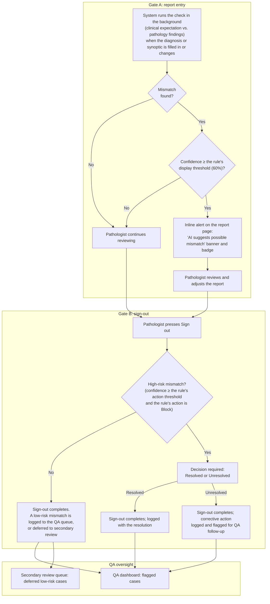

# Clinical-pathologic mismatch check

*For customers, pathologists, QA staff and administrators. Written Oct 11, 2026. Requirements: PS-145 (built), PS-554 (approved redesign: the rules built in Batch 529; the report alert, sign-out and QA queues in Batch 530; the governed AI instructions in Batch 536; earlier versions of this guide said Batch 531, corrected).*

## What it is

When a pathologist reports a case, PathScribe compares **what the ordering clinician expected** with **what the pathologist found**:

- the expectation comes from the order: the clinical indication, the clinical history and, for an autopsy, the clinical cause of death;
- the findings are the diagnosis, the microscopic description and, for an autopsy, the report sections and abnormal organ findings.

If the two disagree in a way that matters, for example a routine polyp that turns out to be malignant, PathScribe points it out so the pathologist can confirm the diagnosis and the clinician can be told.

**The AI does not diagnose.** It reads the two texts and says whether they conflict, which kind of conflict it is, and how confident it is. Every decision is the pathologist's. Only clinical and narrative text is sent to the AI provider, never a patient name, date of birth, MRN or accession number.

It runs at:

| Where | When |
|---|---|
| Surgical pathology | report sign-out |
| Cytology (pathologist track) | each specimen's sign-out. A cytotechnologist's negative sign-out isn't checked. An abnormal GYN screening result is never "unexpected": finding disease is what screening is for. |
| Autopsy | signing the Final Anatomic Diagnosis (FAD). The preliminary (PAD) isn't checked. |

## Kinds of mismatch

| Kind | Meaning | Example |
|---|---|---|
| Unexpected malignancy | The order expected benign or routine; the pathology is malignant. | "Screening colonoscopy, small polyp" → adenocarcinoma |
| Expected malignancy, none found | The order expected cancer; the pathology is benign. | "Suspected lung carcinoma" → organising pneumonia |
| Specimen or organ mis-classification | The site, organ or specimen type doesn't fit the order. | Ordered as thyroid; the findings describe parathyroid |
| Cause-of-death mismatch (autopsy) | The cause of death or a major diagnosis differs from the clinical one (Goldman class I/II). | Clinical "myocardial infarction" → pulmonary thromboembolism |
| Other variance | Any other material disagreement. | — |

---

## How it works today (built: Batches 439, 523, 529 and 530)

**While the pathologist reviews the report (Gate A).** Surgical reports, autopsy reports between the PAD and the FAD, and (Batch 531) each cytology specimen in the Cytology Workspace once its final diagnosis is chosen (pathologist track):

1. About two seconds after the diagnosis (or, for an autopsy, the report sections) is filled in or changed, PathScribe runs the check in the background. Nothing stops the pathologist working.
2. If the AI finds no mismatch, or its confidence is below the rule's **"Alert from"** threshold (60% to start), nothing appears. If the AI can't be reached, a simple built-in rule catches the clearest case: a malignant result on a routine or benign order. There is no fallback rule for autopsy or GYN screening.
3. Otherwise a one-line alert appears on the report, **"AI suggests possible mismatch"**, with the kind and the confidence. It says whether sign-out will ask for a decision (a high-risk mismatch) or not (low risk). **Review** opens it in place: the AI's explanation, the clinical indication, which rule applies, and the decision.
4. The pathologist can decide there, in one click, with an optional quick reason and an optional note:
   - **low risk:** **Resolved**, or **Defer to secondary review**;
   - **high risk:** **Resolved** or **Unresolved**. Deciding now means sign-out won't stop to ask.

   Or they can ignore it and carry on.

**At sign-out (Gate B).** Surgical **Sign out**, autopsy **Sign FAD**, and cytology specimen sign-out (pathologist track):

1. If a decision is already on file for the case (or, in cytology, the specimen), nothing more happens. Otherwise the check runs; for an unchanged report the answer from step 1 above is reused, so the AI is not asked twice.
2. **Suppressed** (below "Alert from"): sign-out goes on.
3. **Low risk** (any alert that doesn't reach a Block rule): sign-out goes on, and the mismatch is **logged to the QA dashboard** (`LOGGED`).
4. **High risk** (a Block rule reached): a **Clinical-pathologic correlation** window opens before the signature. It says which rule held sign-out. The pathologist chooses **Resolved** or **Unresolved** (one click, quick reason and note optional); either lets sign-out go on. Or they go back to the report.

**What is recorded.** Each decision is a QA record ("Clinical-Pathologic Correlation") with the resolution status, the risk, the rule, the quick reason and the note, and an audit entry (`CLINICAL_MISMATCH_DECIDED`, `CLINICAL_MISMATCH_DEFERRED` or `CLINICAL_MISMATCH_LOGGED`). Recording a decision needs `case:clinical-mismatch:record` (Pathologist, Fellow); the automatic `LOGGED` entry is part of sign-out and needs no permission. **Unresolved** recommends a corrective action (CAPA) to the QA lead.

**QA oversight.**
- **QA dashboard:** Quality Assurance → Activities → **Clinical-Pathologic Correlation**. Every flagged case with its resolution status, risk and reason; the tile's "pending" is the number of deferred cases still awaiting secondary review.
- **Secondary review queue:** Worklist → **Surgical QA** → "Deferred clinical mismatches". A pathologist records **Resolved** or **Unresolved** for each; the Worklist tile counts them.

**No clinical information (Pete, Oct 11, 2026: flag rather than block).** Requisitions sometimes arrive with no clinical history, in every specialty. Then:
- Accession is never blocked for it: missing clinical history is shown as a note, and the case is accessioned.
- The check doesn't run (there is nothing to compare), so there is no false alarm. The report page, the Cytology Workspace and the grossing screen show the same notice: "Mismatch check deferred: no clinical information provided", and at sign-out the audit log records `CLINICAL_MISMATCH_CHECK_DEFERRED`.
- Pathologists, fellows, residents and PAs can add or reconcile the coded clinical history later, at grossing, report review or sign-out ("Add clinical history" on the same line; `case:clinical-history:record`, audited). Once there is clinical information, the check runs.

**When the report changes (Batch 531, Pete: "If the diagnosis changes, the check should be rerun").** Each decision keeps a fingerprint of the text it was made on (the indication, the clinical history and the findings). When that text changes, the check runs again. It asks again only if the new result is worse than what was decided: a different kind of mismatch, or one that now reaches a Block rule. A typo fix doesn't re-prompt anyone. When it does ask again, it shows what was decided before.

**Not covered yet:** an amendment or correction after sign-out doesn't run the check (Pete to decide whether a high-risk mismatch should hold an amendment's release).

---

## The approved redesign (PS-554): the design, now built except where marked

Pete's decisions of Oct 11, 2026. The check moves **out of the sign-out moment and into the report review**, and only a **high-risk** mismatch can hold up sign-out. Everything else is tracked by QA after sign-out.

### The workflow

### The rules — built (Batch 529)

**Where:** Configuration → System → Clinical Mismatch Rules. Each row shows the kind of mismatch, the specimen type (or all), "Alert from", "Action at" and the action. A threshold saves when you leave the field; an action saves as soon as you choose it. To tune one specimen type, choose the kind and the specimen type under "A rule for one specimen type"; it starts from the rule for all specimen types and takes precedence for that type. The rule for all specimen types of each kind can be changed but not removed. With several specimen types on a case, the most severe outcome applies.

Since Batch 530, the report page and sign-out use these rules (see "How it works today").

The rules are **system configuration**: one row per specimen type and kind of mismatch. Changes are audited. Each rule has:

| Field | Meaning |
|---|---|
| `specimenType` | The specimen type it applies to, or all. Rules can be tuned per organ system. |
| `mismatchCategory` | One of the kinds above. |
| `minimumDisplayThreshold` | Below this confidence, there is no alert at all. Default **60%**. |
| `actionThreshold` | At or above this confidence, the rule's action applies. |
| `actionType` | **Block** (a decision is needed before sign-out), **Warn** (an alert, no hold) or **Log** (QA queue only). |

The engine evaluates each suggestion in order:

| Confidence | What happens |
|---|---|
| Below `minimumDisplayThreshold` (60%) | Suppressed: no alert. |
| From `minimumDisplayThreshold` up to `actionThreshold` | Alert on the report; logged to the QA queue. Sign-out is not held. |
| At or above `actionThreshold` | The rule's action: Block, Warn or Log. |

The starting rules:

| Kind | Action threshold | Action | Why |
|---|---|---|---|
| Unexpected malignancy | 70% | **Block** | An unexpected cancer changes immediate patient management. |
| Cause-of-death mismatch | 70% | **Block** | A material autopsy discrepancy. |
| Specimen or organ mis-classification | 65% | **Block** | It may mean the wrong specimen or the wrong patient. |
| Expected malignancy, none found | — | **Log** | The clinical expectation was already high-risk, so the absence of malignancy is less likely to endanger immediate management. QA tracks the pattern. |
| Other variance | 65% | **Log** | Expected histologic variation. |

### Sign-out behaviour

| Condition | Sign-out | QA |
|---|---|---|
| No mismatch | Normal | None |
| Low-risk mismatch | Not held; a note is optional | Logged to the QA dashboard |
| Low-risk mismatch, deferred | Not held | The case goes to the secondary review queue |
| High-risk mismatch | **Held until a decision is recorded** | Logged with the decision and note |

**Resolution status** (`resolutionStatus`):

- **RESOLVED**: the mismatch is explained. Sign-out proceeds.
- **UNRESOLVED**: allowed for a high-risk mismatch, and it counts as a decision. Sign-out proceeds, and a corrective action is logged automatically and flagged for QA follow-up.
- **DEFERRED**: for **low-risk** mismatches only. The case goes to the secondary review queue.

**Quick reasons** replace most typing. The note is optional:

- "Expected variation";
- "Clinical context reviewed";
- "Pre-op diagnosis non-specific".

### Governed AI instructions (built, Batch 536)

The instructions PathScribe gives the AI for each discipline (surgical, cytology, autopsy) are configuration, managed like a protocol (**Configuration → System → AI Instructions**):

- PathScribe's own text is version 0, approved with the release;
- **any edit** makes a new version that waits for approval. The check doesn't use the edited text until it is approved; until then it keeps using the approved version;
- the person who edits the text (anyone who edited it since the last approval) cannot approve it. A rejection needs a reason, and the approved version stays in use;
- the **Test** panel runs the check on a sample case with the text in the editor, so the approver can see what the AI does with it before approving. Nothing is recorded on a case;
- every version, edit, approval and rejection is kept: in the screen's history and in the audit log (`AI_PROMPT_EDITED`, `AI_PROMPT_APPROVED`, `AI_PROMPT_REJECTED`);
- each AI suggestion records the version of the instructions it was made with.

Only the instructions can change, not the case details the check fills in or the answer format it reads, so an edit can't break the check.

### Where the AI runs (Batch 536, PS-558)

Every AI call, the mismatch check's included, is checked against the **AI vendor policy** of the jurisdiction the case belongs to (**Configuration → AI Behavior → AI vendor policy**). When the AI service or its hosting region isn't allowed there, the AI isn't asked: the rule-based check runs instead, and the suggestion says "AI is not available for this jurisdiction". PathScribe never switches to a different AI service on its own.

### Who can do what

| Capability | What it allows | Starts with | Notes |
|---|---|---|---|
| `config:clinical-mismatch-rules:manage` | Create and change rules: thresholds, kinds, actions | **No built-in role** | Each hospital grants it to its own role, for example a Pathologist Administrator. Built (Batch 529). |
| `config:ai-prompt:approve` | Approve or reject the AI instructions | **Lab Director** | Never Superadmin (Pete). Built (Batch 536). |
| `config:ai-prompt:edit` | Edit the AI instructions (a new version, pending approval) | **No built-in role** | Each hospital grants it. Built (Batch 536). |
| `config:ai-prompt:view` | Read the AI instructions and their history | **QA Reviewer, Lab Director** | Built (Batch 536). |
| `config:clinical-mismatch-rules:view` | Read the rules | **Pathologist, QA Reviewer, Lab Director** | So a pathologist can see why a case was held. This is a deliberate exception to least privilege (Pete). Built (Batch 529). |
| `case:clinical-mismatch:record` (existing) | Record a decision on a case: Resolved, Unresolved or Deferred, at report review, at sign-out, or in the secondary review | Pathologist, Fellow | Statuses built (Batch 530). |

**Separation of duties** (built, Batch 536). One person can't hold both `config:clinical-mismatch-rules:manage` and `config:ai-prompt:approve`. PathScribe refuses:

- granting both to one role;
- assigning a person roles that together carry both;
- changing a role so that someone who holds it and another role would carry both.

Superadmin, which is reserved for ForMedrixAI support, has no bypass, and does not hold the approval at all (Pete, Oct 11): ForMedrixAI tests approval with a Lab Director test account in a demonstration or test tenant. Superadmin can still read and edit the instructions; an edit waits for the laboratory's approval.

As in all of PathScribe, permissions are granted to **roles**, and an administrator assigns roles to people (Configuration → Staff, Role Dictionary). The API server keeps the assignment history (who assigned it, when, and whether it is active); see `docs/architecture/AUTHORIZATION_API.md`.

---

## Questions customers ask

**Does the AI change the report?** No. It only suggests. The pathologist decides and the report is the pathologist's.

**What does the AI see?** The clinical indication and history, and the findings text. No patient identifiers.

**What if the requisition has no clinical history?** Intake goes ahead; the check is deferred, the report says so, and the audit log records it. The history can be added later, and the check then runs.

**Can a mismatch stop a report from going out?** Only a high-risk one, and only until the pathologist records a decision. "Unresolved" is a decision: the report goes out and QA follows up.

**Can we tune it?** Yes (built, Batch 529). The thresholds and actions are per kind and per specimen type, and only people your lab authorises can change them. Each change is audited.

**Where is it tracked?** In the QA dashboard (flagged cases), the secondary review queue (deferred cases) and the CAPA engine (unresolved high-risk mismatches).
